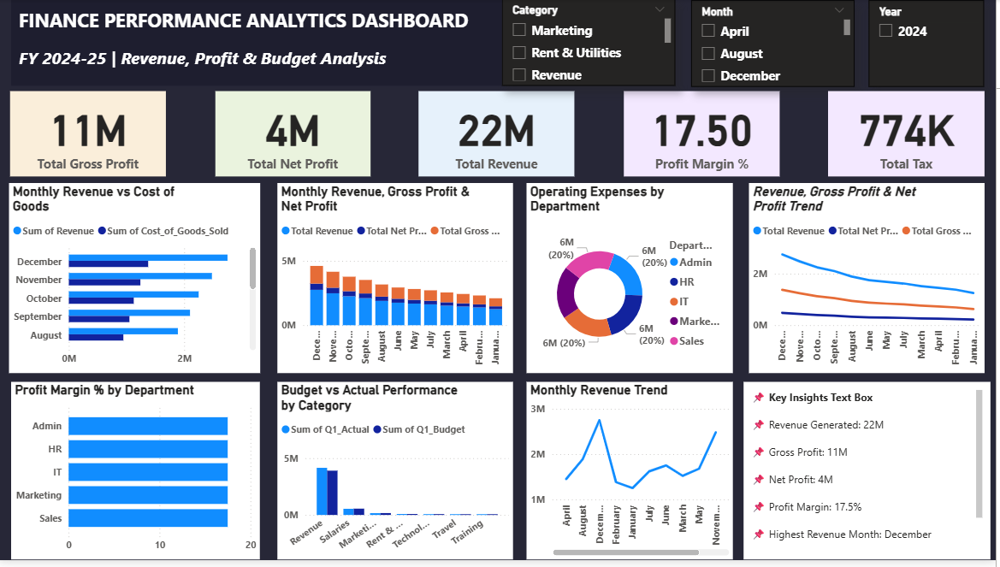

# 📊 Finance Performance Analytics Dashboard

## 📌 Overview

This project is an interactive Finance Performance Analytics Dashboard developed using Microsoft Power BI. It provides insights into revenue, expenses, cash flow, profit & loss, and budget performance through interactive visualizations.

---

## 🛠️ Tools & Technologies

- Microsoft Power BI
- Power Query
- DAX
- CSV Dataset

---

## 📈 Dashboard Features

- Executive KPI Cards
- Budget vs Actual Analysis
- Profit & Loss Analysis
- Cash Flow Analysis
- Expense Analysis
- Interactive Slicers & Filters

---

## 📂 Dataset Files

- finance_budget_vs_actual.csv
- finance_cashflow.csv
- finance_expenses.csv
- finance_pl.csv

---

## 🖼️ Dashboard Preview

---

## 📁 Project File

- FINANCE PERFORMANCE ANALYTICS DASHBOARD.pbix

---

## 👨‍💻 Author

**Shivanna GJ**
